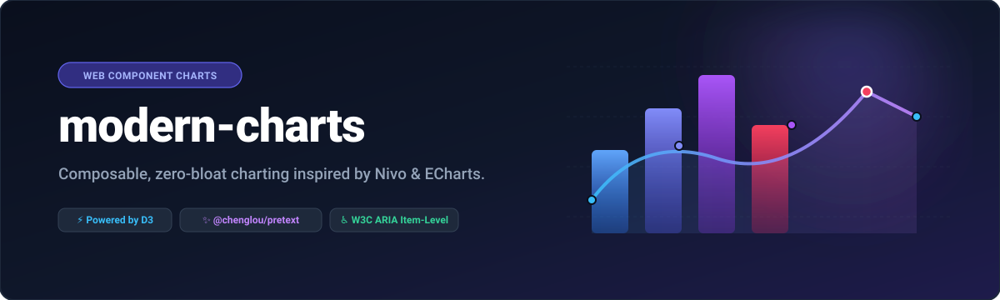

<div align="center">



# modern-charts

Web Component charts built with D3 and Pretext.

<p align="center">
  <a href="https://www.npmjs.com/package/modern-charts"></a>
  <a href="https://github.com/jingcai86/modern-charts/actions/workflows/ci.yml"></a>
  <a href="https://github.com/jingcai86/modern-charts/actions/workflows/lighthouse.yml"></a>
  <a href="https://github.com/jingcai86/modern-charts/actions/workflows/codeql.yml"></a>
  <a href="https://github.com/jingcai86/modern-charts/blob/main/.size-limit.json"></a>
  <a href="https://github.com/jingcai86/modern-charts/actions/workflows/ci.yml"></a>
  <a href="https://opensource.org/licenses/MIT"></a>
  <a href="https://www.typescriptlang.org/"></a>
</p>

[Live Studio](https://jingcai86.github.io/modern-charts/) · [Documentation wiki](https://github.com/jingcai86/modern-charts/wiki) · [npm](https://www.npmjs.com/package/modern-charts)

</div>

## Use

Install the current alpha release:

```bash
npm install modern-charts@alpha
```

In an application served by a JavaScript bundler, import a chart and assign its configuration:

<p align="center">
  <a href="https://jingcai86.github.io/modern-charts/#/chart/bar"></a>
</p>

```html
<mc-bar-chart id="spending" style="display: block; width: 100%; height: 360px;"></mc-bar-chart>

<script type="module">
  import 'modern-charts/bar';

  const chart = document.getElementById('spending');
  chart.config = {
    data: [
      { quarter: 'Q1', Cloud: 142, Edge: 94 },
      { quarter: 'Q2', Cloud: 168, Edge: 118 }
    ],
    indexBy: 'quarter',
    keys: ['Cloud', 'Edge'],
    title: 'Quarterly spending',
    palette: 'shadcn',
    themeMode: 'system'
  };
</script>
```

Give the chart a sized container. Import `modern-charts` to register every chart, or use a [per-chart entry point](https://github.com/jingcai86/modern-charts/wiki/Chart-Components). Replace `chart.data` or assign a new `chart.config` to update it.

See the wiki for [features](https://github.com/jingcai86/modern-charts/wiki/Features), [components](https://github.com/jingcai86/modern-charts/wiki/Component-Architecture), [Studio guides](https://github.com/jingcai86/modern-charts/wiki/Studio-and-Guides), [internationalization](https://github.com/jingcai86/modern-charts/wiki/Internationalization), and [AI context](https://github.com/jingcai86/modern-charts/wiki/AI-Context).

## Build

Use Node.js 22.12+ and npm.

```bash
git clone https://github.com/jingcai86/modern-charts.git
cd modern-charts
npm ci
npm run dev
```

Open the Studio at [localhost:5173](http://localhost:5173).

```bash
npm run build         # Library and TypeScript declarations → dist/
npm run build:apps    # Studio and documentation assets → dist-examples/
npm run preview:apps  # Preview the built Studio
```

To run with Docker:

```bash
docker compose up --build                                      # Studio at localhost:8080
docker compose --profile dev up --build modern-charts-dev      # Hot reload at localhost:5173
```

## Contribute

[Report a bug](https://github.com/jingcai86/modern-charts/issues/new?template=bug_report.yml), [propose a feature](https://github.com/jingcai86/modern-charts/issues/new?template=feature_request.yml), or open a pull request against `main`. Include a reproduction for fixes and tests for behavior changes.

Before submitting a pull request, run:

```bash
npm test
npx tsc --noEmit
npm run lint:web
npm run sync:context
npm run build
npm run size
npm run build:apps
```

Review and include any generated context changes when updating chart defaults. CI also runs coverage, CodeQL, bundle-size checks, and a Lighthouse audit.

The library is in [`src/`](src/), the Studio in [`apps/studio/`](apps/studio/), machine-readable documentation in [`apps/context/`](apps/context/), and tests in [`tests/`](tests/).

Licensed under [MIT](LICENSE).
