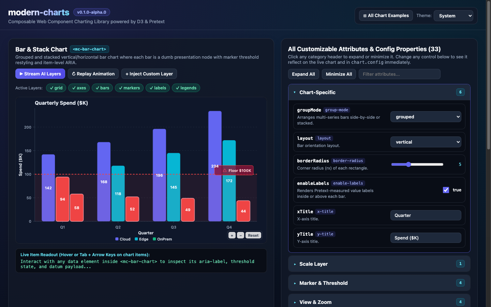
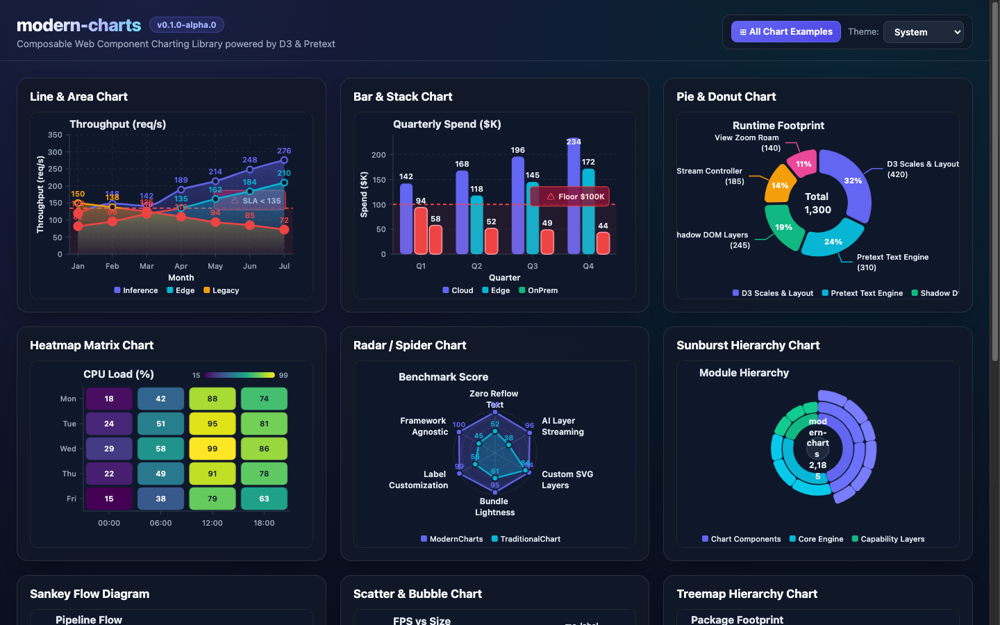

<div align="center">


# 📊 modern-charts (`v0.1.0-alpha.0`)

**Composable, Accessible Web Component Charting Library powered exclusively by D3 &amp; Pretext**

<p align="center">
  <a href="https://www.npmjs.com/package/modern-charts"></a>
  <a href="https://github.com/jingcai86/modern-charts/actions/workflows/ci.yml"></a>
  <a href="https://github.com/jingcai86/modern-charts/actions/workflows/deploy-pages.yml"></a>
  <a href="https://github.com/jingcai86/modern-charts/actions/workflows/codeql.yml"></a>
  <a href="https://github.com/jingcai86/modern-charts"></a>
  <a href="https://github.com/jingcai86/modern-charts"></a>
  <a href="https://github.com/jingcai86/modern-charts"></a>
  <a href="https://opensource.org/licenses/MIT"></a>
  <a href="https://www.typescriptlang.org/"></a>
</p>

### 🚀 [Explore Live Interactive Demo &amp; Catalog](https://jingcai86.github.io/modern-charts/)

<p align="center">
  <a href="#-features-at-a-glance">Features</a> •
  <a href="#-10-production-grade-chart-components">Chart Gallery</a> •
  <a href="#-quick-start">Quick Start</a> •
  <a href="#-interactive-studio-playground">Studio Playground</a> •
  <a href="#-docker-quickstart">Docker</a> •
  <a href="#-contributing--issue-templates">Contributing</a>
</p>

---

</div>

<br />

<div align="center">
  
  <p><em>The modern-charts Studio Playground — Live minimizable attribute controls, Web Component markup generation, and accessible ARIA inspection.</em></p>
</div>

<br />

## ✨ Features at a Glance

| Feature | Description |
| :--- | :--- |
| 🎯 **Nivo-Style Single `chart.config`** | Configure data, scales, animation, labels, ARIA, and custom layer pipelines via a single clean JavaScript object. |
| 🧩 **Autonomous Sub-Components** | Declarative child Web Components (`<mc-theme-layer>`, `<mc-scale-layer>`, `<mc-view-layer>`, `<mc-animation-layer>`, `<mc-aria-layer>`, `<mc-label>`) populated automatically underneath. |
| ⚡ **Zero Framework Lock-in** | Native Web Components (Custom Elements) that run anywhere: React, Vue, Svelte, Angular, Solid, or Vanilla HTML. |
| 🪶 **Zero-Bloat Runtime** | Strictly zero runtime dependencies beyond [`d3`](https://d3js.org/) and [`@chenglou/pretext`](https://github.com/chenglou/pretext). |
| ♿ **W3C ARIA & WCAG 2.1 AA** | Every single visual data item (bar, slice, point, cell, arc, link) is a focusable ARIA item (`.mc-aria-item`) with keyboard navigation and live announcer. |
| ✨ **Pretext Ultra-Fast Typography** | Instant zero-DOM-reflow text measurement and line-breaking via `@chenglou/pretext` in both SVG and HTML `<foreignObject>`. |
| 🎞️ **Nivo-Style Motion & Spring Physics** | Spring presets (`default`, `gentle`, `wobbly`, `stiff`, `slow`, `molasses`, `elastic`, `bounce`) respecting `prefers-reduced-motion`. |
| 🤖 **AI Progressive Layer Streaming** | Stream visual chart layers onto the canvas step-by-step in real-time (`chart.streamLayers()`). |

---

## 🎨 10 Production-Grade Chart Components

| Component Tag | Chart Type | Key Built-in Layers | Live Demo |
| :--- | :--- | :--- | :---: |
| [`<mc-line-chart>`](https://jingcai86.github.io/modern-charts/#/chart/line) | 📈 **Line & Area Chart** | `grid`, `axes`, `areas`, `lines`, `points`, `labels`, `crosshair`, `markers`, `legends` | [**View Demo** ↗](https://jingcai86.github.io/modern-charts/#/chart/line) |
| [`<mc-bar-chart>`](https://jingcai86.github.io/modern-charts/#/chart/bar) | 📊 **Bar & Stack Chart** | `grid`, `axes`, `bars`, `labels`, `markers`, `legends` (Grouped, Stacked, Diverging) | [**View Demo** ↗](https://jingcai86.github.io/modern-charts/#/chart/bar) |
| [`<mc-pie-chart>`](https://jingcai86.github.io/modern-charts/#/chart/pie) | 🍩 **Pie & Donut Chart** | `arcs`, `labels`, `legends` (Padded, Rounded, Sliced, Center Value) | [**View Demo** ↗](https://jingcai86.github.io/modern-charts/#/chart/pie) |
| [`<mc-heatmap-chart>`](https://jingcai86.github.io/modern-charts/#/chart/heatmap) | 🧱 **Heatmap Matrix Chart** | `grid`, `axes`, `cells`, `labels`, `legend` (Continuous / Quantize Diverging) | [**View Demo** ↗](https://jingcai86.github.io/modern-charts/#/chart/heatmap) |
| [`<mc-radar-chart>`](https://jingcai86.github.io/modern-charts/#/chart/radar) | 🕸️ **Radar / Spider Chart** | `grid`, `axes`, `polygons`, `lines`, `points`, `labels`, `legend` | [**View Demo** ↗](https://jingcai86.github.io/modern-charts/#/chart/radar) |
| [`<mc-sunburst-chart>`](https://jingcai86.github.io/modern-charts/#/chart/sunburst) | ☀️ **Sunburst Hierarchy** | `arcs`, `labels` (Radial Tree Layout, Interactive Drilling) | [**View Demo** ↗](https://jingcai86.github.io/modern-charts/#/chart/sunburst) |
| [`<mc-sankey-chart>`](https://jingcai86.github.io/modern-charts/#/chart/sankey) | 🔀 **Sankey Flow Diagram** | `links`, `nodes`, `labels` (Curved Flow Paths, Node Reordering) | [**View Demo** ↗](https://jingcai86.github.io/modern-charts/#/chart/sankey) |
| [`<mc-scatter-chart>`](https://jingcai86.github.io/modern-charts/#/chart/scatter) | 🫧 **Scatter & Bubble Chart** | `grid`, `axes`, `points`, `labels`, `markers`, `legends` (Variable Radii) | [**View Demo** ↗](https://jingcai86.github.io/modern-charts/#/chart/scatter) |
| [`<mc-treemap-chart>`](https://jingcai86.github.io/modern-charts/#/chart/treemap) | 🗂️ **Treemap Hierarchy** | `nodes`, `labels` (Squarified Tiling with Responsive Pretext Wrapping) | [**View Demo** ↗](https://jingcai86.github.io/modern-charts/#/chart/treemap) |
| [`<mc-gauge-chart>`](https://jingcai86.github.io/modern-charts/#/chart/gauge) | 🧭 **Radial Gauge Chart** | `track`, `ticks`, `valueArc`, `marker`, `labels` (Target Threshold Line & Ticks) | [**View Demo** ↗](https://jingcai86.github.io/modern-charts/#/chart/gauge) |

---

## ⚡ Quick Start

### 1. Installation

```bash
npm install modern-charts
```

### 2. Basic Usage

```html
<!-- Include in any HTML, React, Vue, or Svelte component -->
<mc-bar-chart id="my-chart" style="width: 100%; height: 420px;"></mc-bar-chart>

<script type="module">
  import 'modern-charts';

  const chart = document.getElementById('my-chart');

  chart.config = {
    data: [
      { quarter: 'Q1', Cloud: 142, Edge: 94 },
      { quarter: 'Q2', Cloud: 168, Edge: 118 },
      { quarter: 'Q3', Cloud: 196, Edge: 145 },
      { quarter: 'Q4', Cloud: 234, Edge: 172 }
    ],
    indexBy: 'quarter',
    keys: ['Cloud', 'Edge'],
    groupMode: 'grouped',
    title: 'Quarterly Cloud vs Edge Infrastructure Spend ($K)',

    // Theming & Palette
    themeMode: 'system',
    palette: 'nivo',

    // Scales
    xScale: { type: 'band', padding: 0.28 },
    yScale: { type: 'linear', min: 0, max: 'auto' },

    // Animations & Motion Presets
    animate: true,
    motionConfig: 'wobbly',

    // Accessible ARIA Configuration
    ariaLabel: 'Quarterly Cloud vs Edge Spend',
    isFocusable: true,
    barAriaLabel: (d) => `${d.seriesId} in ${d.category}: $${d.value}K`,

    // Pretext Non-Reflow Typography
    labelMode: 'foreignObject',

    // Composable Layer Pipeline
    layers: ['grid', 'axes', 'bars', 'labels', 'legends']
  };
</script>
```

---

## 🧩 Universal Sub-Component Architecture

Every `modern-charts` component exposes programmatic and declarative access to its underlying layers:

```
<mc-bar-chart>
  ├── <mc-theme-layer>       (Palette, font tokens, light/dark mode)
  ├── <mc-scale-layer>       (Band, linear, time, log, radial scales)
  ├── <mc-view-layer>        (Pan, zoom, Roam transforms, viewBox)
  ├── <mc-animation-layer>   (Spring physics, staggering, reduced motion)
  ├── <mc-aria-layer>        (Item-level focus, keyboard roving, live announcer)
  └── <mc-label>             (@chenglou/pretext zero-reflow label renderer)
```

You can inspect or manipulate sub-components directly:

```ts
const { themeLayer, scaleLayer, ariaLayer, animationLayer } = chart.getSubComponents();
```

---

## 🖼️ Gallery Overview

<div align="center">
  
  <p><em>The full interactive chart gallery with direct live playground links for all 10 chart components.</em></p>
</div>

---

## 🐳 Running with Docker

Run the entire showcase in Docker with zero local Node.js setup:

### Production Nginx Demo (`http://localhost:8080`)

```bash
docker compose up --build
# Or via npm script:
npm run docker:up
```

### Hot-Reload Development Server (`http://localhost:5173`)

```bash
docker compose --profile dev up --build
# Or via npm script:
npm run docker:dev
```

---

## 🤝 Contributing & Issue Templates

Contributions, issue reports, and feature proposals are warmly welcome!

- 🐛 [**Report a Bug**](https://github.com/jingcai86/modern-charts/issues/new?template=bug_report.yml) (includes structured reproduction steps, observed vs. expected behavior, and config snippets).
- 💡 [**Request a Feature**](https://github.com/jingcai86/modern-charts/issues/new?template=feature_request.yml) (propose new chart types, layers, or animation presets).
- 📥 [**Open a Pull Request**](https://github.com/jingcai86/modern-charts/pulls) (comes with built-in test checklists and before/after screenshot comparisons).

---

## 📄 License

Distributed under the **MIT License**. See [LICENSE](./LICENSE) for details.
